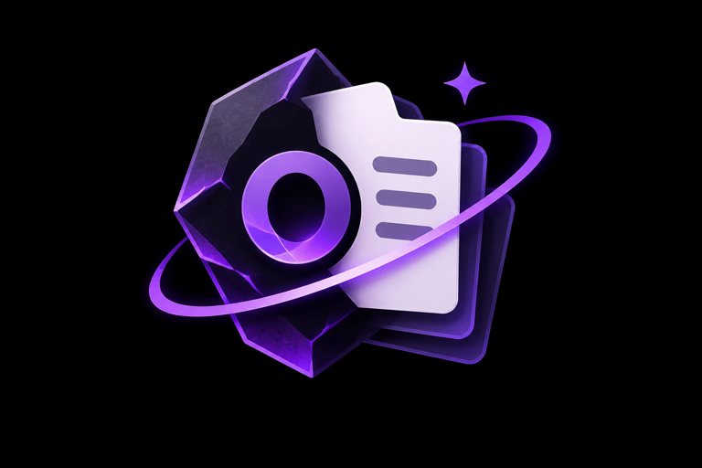

<p align="center">
  
</p>

<h1 align="center">Oxide</h1>

<p align="center">A local native workspace for notes and searchable screenshots, with a user-controlled recording-exclusion toggle on Windows.</p>

<p align="center">
  <a href="https://github.com/DrunkTrader/oxide/actions/workflows/ci.yml"></a>
  <a href="LICENSE"></a>
  
  
</p>

<p align="center">
  <a href="docs/QUICKSTART.md">Quick start</a> ·
  <a href="docs/ARCHITECTURE.md">Architecture</a> ·
  <a href="docs/CONTRIBUTING.md">Contributing</a> ·
  <a href="docs/SECURITY.md">Security</a> ·
  <a href="docs/CHANGELOG.md">Changelog</a>
</p>

Oxide keeps your notes and screenshots together and makes the text inside every screenshot searchable. Everything runs on your device: no account, no cloud, and OCR happens in a local process. Capture what you need when you need it; Oxide is not an always-on screen recorder.

## Features

**Notes**
- Autosaving notes with a **Saved locally** acknowledgement, note trash, duplicate and Markdown export with images
- Tags, a **Today** daily note, and a global shortcut that opens Oxide with a new note

**Screenshots**
- Capture a display or a region of a frozen preview, import or paste images, or index existing screenshot folders
- **Region into a new note**, and **Copy text from region**, which copies recognized text without saving the image
- Detail view with highlighted matches, copy or insert recognized lines, and attach to any note

**Search**
- One literal search across notes and the text inside screenshots
- Filters for date, folder, tag and source app

**Privacy**
- Records which app and window each capture came from, and skips captures while a password manager or private browsing window is active
- Redact selected text lines in an original image
- On Windows, optional recording exclusion keeps Oxide out of screen sharing and recordings
- Oxide never appears in its own screenshots

**Desktop integration**
- Configurable global shortcuts, a resident background instance, optional login startup, and a Windows tray icon
- Light and dark themes (or follow the system), switchable from the header, with a violet accent from the Oxide logo

## Platform support

| Capability | Windows | Linux (X11) | Linux (Wayland) | macOS |
|---|---|---|---|---|
| Notes, OCR, search | Yes | Yes | Yes | Not built |
| Screenshot capture | Yes | Yes | No | Not built |
| Capture source and Never capture list | Yes | Yes | No | Not built |
| Recording exclusion | Yes | No | No | Not built |
| Tray icon | Yes | No | No | Not built |

## Install

Download the file for your system from the [latest release](https://github.com/DrunkTrader/oxide/releases/latest):

| Your system | File | Install |
|---|---|---|
| Debian, Ubuntu, Linux Mint, Pop!_OS | `oxide_<version>_amd64.deb` | `sudo apt install ./oxide_<version>_amd64.deb` |
| Fedora, RHEL, openSUSE | `oxide-<version>-1.x86_64.rpm` | `sudo dnf install ./oxide-<version>-1.x86_64.rpm` (openSUSE: `sudo zypper install ./…`) |
| Any Linux distribution | `Oxide-<version>-x86_64.AppImage` | `chmod +x Oxide-*.AppImage && ./Oxide-*.AppImage` |
| Any Linux distribution | `oxide-<version>-linux-x86_64.tar.gz` | extract and run `./oxide-app` (keep `oxide-worker` beside it) |
| Windows 10/11 | `Oxide-Setup-<version>.exe` | run the installer (per user, no admin rights) |
| Windows 10/11, portable | `oxide-<version>-windows-x86_64.zip` | extract and run `oxide-app.exe` |

Each release lists `SHA256SUMS.txt` to verify downloads. Releases are built by `.github/workflows/release.yml` when a `v*` tag is pushed.

## Getting started

New to Oxide? Follow the **[Quick start](docs/QUICKSTART.md)**.

Requirements:

- Rust **1.95 or newer**
- a C compiler (SQLite is bundled)
- a native desktop session
- **Windows:** the MSVC toolchain (Visual Studio C++ Build Tools with the Windows SDK)
- **Linux:** an X11 desktop for capture, plus OpenGL/EGL/XKB runtime libraries

```sh
cargo build --workspace --locked
cargo run -p oxide-app --locked
```

Build the complete workspace so `oxide-worker` is beside `oxide-app`. Notes and cached search remain available if the reader cannot start.

**Windows installer.** Build both release binaries, then compile `packaging/windows/oxide.iss` with Inno Setup 6:

```sh
cargo build --workspace --release --locked
iscc packaging/windows/oxide.iss
```

The installer (`dist/Oxide-Setup-<version>.exe`) installs per user, adds a Start-menu shortcut, and the app and installer carry the Oxide icon.

## Using Oxide

1. Choose a capture directory and optional existing screenshot folders in Settings.
2. Create a note and watch for **Saved locally**. Notes autosave after about 500 ms of inactivity.
3. Capture a display, or select a region of a frozen display preview. Region coordinates can also be entered with the keyboard.
   - New captures attach to the note that was active when the capture started.
   - Library captures can stay unattached.
   - **Region into a new note** creates a note for the capture.
4. Use **Copy text from region** to copy recognized text without saving an image, optionally joining lines into one paragraph.
5. Search notes, screenshots or **All** results. Open an image to see highlighted lines, copy text, insert lines into a note, or attach it elsewhere.
6. Tag notes and screenshots. Tags appear in the sidebar. **Today** opens or creates a note titled with the current date.
7. Export a note to Markdown with copied images and relative links. Notes go to a persistent note trash; images go to the recoverable system trash after confirmation.

Notes are written in Markdown. Switch the editor between **Edit** and **Preview** (Ctrl/Cmd+E) to see headings, lists, task lists, tables, quotes and code rendered; ticking a task-list checkbox in Preview updates the note. The preview never loads remote images.

### Shortcuts

| Action | Default |
|---|---|
| Summon / hide | Alt+Shift+O |
| Hide all | Alt+Shift+H |
| Capture region | Alt+Shift+R |
| Capture display | Alt+Shift+D |
| Copy text from region | Alt+Shift+T |
| Summon and start a new note | Alt+Shift+N |
| New note | Ctrl+N / Cmd+N |
| Save now | Ctrl+S / Cmd+S |
| Edit / Preview Markdown | Ctrl+E / Cmd+E |
| Search focus | Ctrl+K or Ctrl+F / Cmd+K or Cmd+F |
| Close panel / hide | Escape |

Global shortcuts are configurable in Settings, validated for duplicates, and report registration conflicts. Closing the window hides the resident app; **Quit** saves pending edits before exiting. Launching Oxide again summons the running instance.

### Search

Text terms are literal substrings, and all terms must occur in the same note or screenshot. Screenshot terms may span OCR lines. Quotes, percent signs, underscores and FTS keywords cannot inject SQL or change the search grammar.

```text
database error
date:2026-10-07
after:2026-10-01 before:2026-11-01
in:"/home/user/Pictures/Screenshots" error
tag:work invoice
app:firefox
```

- **Scope:** folder (`in:`) and `app:` filters scope results to screenshots. `tag:` matches notes and screenshots; several tags must all be present.
- **Filters menu:** offers date and folder controls.
- **Dates:** use local calendar days, a note's last edit time, and a screenshot's capture time. For imported or recovered images, that is the file's modification time. The detail view shows which timestamp was stored.
- **Results:** have Load more controls.

Semantic or approximate search is not part of this build.

### Capture privacy

- **Capture source.** Each capture records the foreground app and window title (Windows and X11). The detail view shows it, and `app:` filters by it. Oxide's own window is never recorded as a source.
- **Never capture.** Settings → Privacy skips a capture while the active window's app or title contains a listed entry. Defaults cover common password managers and private-browsing windows. Wayland exposes no active window, so the list cannot match there.
- **Redaction.** **Redact selected…** in the image detail view paints opaque black over the selected OCR lines. After confirmation it rewrites the original file in place, removes the text from search, and reads the image again. This changes the original image and cannot be undone.

### Recording exclusion (Windows)

The **Recording exclusion** toggle appears in the header and in Settings.

- **On:** applies `WDA_EXCLUDEFROMCAPTURE` to Oxide's window before content is shown. Menus and dialogs drawn inside that window inherit it.
- **Off:** allows ordinary recording and sharing of Oxide.
- The preference survives restart. Switching does not restart the app or clear notes or search.
- Oxide always omits its own UI from its screenshots, independently of this toggle.

Exclusion is best-effort. It is **not yet runtime-validated** for OBS, Zoom, Teams or Meet, `PrintWindow`-based capture ignores it, and local software can turn it off. See [SECURITY](docs/SECURITY.md) for the full threat model. Linux builds show exclusion as unavailable.

If a treatment change fails, Oxide hides private content. Use the tray action **Recording exclusion Off**, or launch:

```sh
oxide-app --normal
```

## Local OCR and offline use

The separate reader uses **ocrs with RTen CPU inference**. On first use it downloads two checksum-pinned ONNX model files and verifies their hashes on every load. Image pixels and recognized text are never uploaded. Notes, capture and cached search work without a network.

```sh
cargo run -p oxide-worker --locked -- --setup-models
```

- **Offline:** after provisioning, set `OXIDE_OFFLINE=1` to prohibit download attempts.
- **Manual models:** you can also place the models in the workspace's `models/` directory, using the exact names and SHA-256 pins in `crates/ocr/src/lib.rs`.
- **Output:** OCR keeps raw strings and normalized line boxes. The engine exposes no recognition confidence, so stored confidence is `null`, not a fabricated score.
- **Languages:** current models target Latin text.

## Storage and recovery

- **Database:** SQLite with WAL, foreign keys, FULL durability, and transactional note and search-index updates.
- **What is kept vs rebuilt:** notes, stable screenshot IDs, attachments and tags are canonical. OCR text and thumbnails are derived and can be rebuilt.
- **Originals:** images stay as files in the capture directory or their original locations, never as database blobs.
- **Imports and watched folders:** manual imports stay indexed independently of watched folders. Removing a watched folder drops its derived search content but keeps note links.
- **Saving:** acknowledged saves survive restart. A failed save keeps your text and offers retry or export.
- **Schema changes:** unsupported schema versions are refused without resetting data. Migrating to schema 4 (tags and capture sources) makes a no-clobber backup first. A migrated database cannot be opened by older builds.
- **Cache:** clearing it removes generated thumbnails only. Keep originals and watched folders outside the cache directory.
- **Backups:** **Back up database** in Settings saves a consistent snapshot; back up screenshot folders separately. Updates and uninstall never remove your data or images.
- **Encryption:** data, OCR text, WAL files and caches are unencrypted under your OS user. Recording exclusion is not encryption.

## Development

Use a disposable workspace so you never touch real data. On Linux keep the path short, because the resident socket path must fit `SUN_LEN`.

```sh
oxide-app --data-dir /absolute/path/to/disposable-workspace
oxide-worker --data-dir /absolute/path/to/disposable-workspace --index /absolute/path/to/images
oxide-worker --data-dir /absolute/path/to/disposable-workspace --search "visible phrase"
oxide-worker --data-dir /absolute/path/to/disposable-workspace --ocr /absolute/path/to/image.png
```

`--background` starts the app hidden. `--no-worker` runs notes and cached search without the OCR child. Logs are local (`reader.log`, stderr, optional `RUST_LOG`).

Checks (CI runs these on Linux and Windows):

```sh
cargo fmt --all --check
cargo check --workspace --all-targets --locked
cargo test --workspace --locked
cargo clippy --workspace --all-targets --locked -- -D warnings
cargo run -p oxide-worker --example pipeline_smoke --locked -- /absolute/path/to/disposable-workspace
cargo run -p oxide-core --example search_bench --locked
xvfb-run -a -s "-screen 0 1280x800x24" python3 tests/gui_smoke.py
```

- **Pipeline check:** runs real local OCR on a generated fixture, then checks search, attachments, export, cache clearing and note recovery.
- **GUI check:** uses real X11 keyboard events to check autosave, own-UI exclusion from captures, hide and wake, and restart. It needs libXtst, Xvfb, X11 utilities and FFmpeg.
- **Search benchmark:** covers 10,000 screenshots and 1,000 notes.

See [CONTRIBUTING](docs/CONTRIBUTING.md) for conventions and [ARCHITECTURE](docs/ARCHITECTURE.md) for how the pieces fit.

## Not yet supported

- Encryption at rest
- Multilingual OCR
- Semantic search
- Wayland capture
- macOS
- Sync

## Documentation

All project documentation lives in [`docs/`](docs):

| Document | What it covers |
|---|---|
| [Quick start](docs/QUICKSTART.md) | Install, first note, first capture, search, where data lives, troubleshooting |
| [Architecture](docs/ARCHITECTURE.md) | Crates, runtime model, data flow, storage schema, search and platform matrix |
| [Contributing](docs/CONTRIBUTING.md) | Setup, required checks, data-safety and code conventions, commits |
| [Security](docs/SECURITY.md) | Threat model and how to report a vulnerability |
| [Changelog](docs/CHANGELOG.md) | Notable changes per release |

## Support

Oxide is free and open source. If it saves you time, you can [sponsor its development on GitHub](https://github.com/sponsors/DrunkTrader). Found a bug? [Open an issue](https://github.com/DrunkTrader/oxide/issues/new); Settings → About in the app opens one pre-filled with your version and OS.

## License

Oxide is licensed under the [GNU General Public License v3.0 or later](LICENSE). It bundles the Inter typeface (`assets/fonts/`, SIL Open Font License 1.1) and a patched copy of `egui_commonmark_backend` (`vendor/`, MIT or Apache-2.0).

---

<p align="center">Made by <a href="https://github.com/DrunkTrader">DrunkTrader</a></p>
